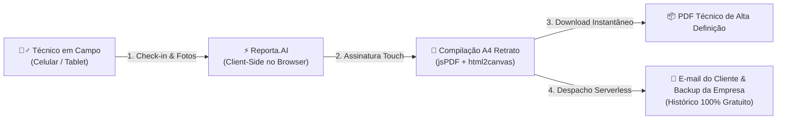

# Reporta.AI ⚡
### Plataforma SaaS Serverless para Relatórios Técnicos de Campo em A4 Retrato

---

## 📌 Visão Geral do Projeto

O **Reporta.AI** é uma plataforma ágil, autônoma e serverless (`HTML5 + Tailwind CSS + Vanilla JS`) desenvolvida para digitalizar rotinas de vistoria e transformar atividades de campo em relatórios técnicos de alto padrão corporativo com layout técnico limpo.

Projetada para atender com excelência desde **prestadores de serviços em geral** até **engenheiros, eletrotécnicos e equipes de manutenção predial e industrial**, a ferramenta elimina o retrabalho administrativo ao consolidar Ordens de Serviço (O.S.), auditoria fotográfica em grade de 3 colunas e coleta de assinaturas digitais em PDFs executivos no padrão **A4 Retrato (Portrait: 210mm × 297mm)** — prontos para emissão e entrega direta no local de atendimento.

A aplicação opera **100% no navegador (Client-Side)** com arquitetura serverless para despacho e arquivamento automatizado por e-mail, dispensando servidores dedicados, bancos de dados relacionais e custos recorrentes de infraestrutura.

### 🔄 Fluxo Operacional


### 🎯 Problema vs. Solução
- **Sem o Reporta.AI:** Fotos perdidas no WhatsApp, pranchetas de papel amassadas, horas perdidas à noite digitando relatórios no Word/Excel e atraso no faturamento do serviço.
- **Com o Reporta.AI:** Documentação padronizada no ato da vistoria, fotos etiquetadas, aceite do cliente coletado na tela via assinatura touch e envio imediato do PDF por e-mail.

---

## 🚀 Principais Funcionalidades

1. **Personalização Dinâmica de Identidade Visual:**
   - Upload de logotipo da contratada com preview em tempo real.
   - Compressão client-side em canvas para evitar lentidão ou estouro de memória.
   - Armazenamento automático no `localStorage` do navegador (a empresa preenche seus dados cadastrais uma única vez).
   - Dados editáveis: Razão Social, CNPJ, Telefone, E-mail e Endereço da Sede.

2. **Gestão Completa de O.S. e Cliente:**
   - Botão para carimbagem automática de data e hora atual (Check-in e Check-out).
   - Endereço da intervenção e escopo técnico solicitado.

3. **Relato Técnico de Execução & Fotos ("Antes e Depois"):**
   - Criação dinâmica de múltiplos blocos de demandas/atividades técnicas.
   - Upload múltiplo de fotos com grade de 3 colunas no PDF.

4. **Geração de PDF Corporativo em A4 Retrato (Padrão Oficial):**
   - Dimensões exatas: `210mm x 297mm`.
   - Paginação automática inteligente — nunca corta fotos ou tabelas ao meio.
   - Quadro de Assinatura Digital com suporte a touch screen e validação de nome em tempo real.
   - Pré-visualização modal antes de baixar.

5. **Estratégia Serverless de Envio por E-mail (3 opções):**
   - **Opção A — Vercel + Resend:** PDF real em anexo via Serverless Function.
   - **Opção B — EmailJS:** Envio direto do navegador, sem backend.
   - **Opção C — Mailto:** Abre o cliente de e-mail nativo (Gmail, Outlook).

---

## 📋 Mapeamento Completo dos Campos Disponíveis

A estrutura de dados do Reporta.AI é diagramada com fidelidade milimétrica para atender às exigências de fiscalização técnica, auditorias contratuais e vistorias periciais em campo:

### 1. Cabeçalho & Dados da Empresa Emissora
| Campo | Descrição | Persistência |
|---|---|---|
| **Logotipo da Empresa** | Upload de imagem corporativa (PNG, JPG, WEBP) renderizada no topo esquerdo do relatório. | `localStorage` |
| **Razão Social / Nome** | Nome empresarial oficial ou nome fantasia da contratada. | `localStorage` |
| **CNPJ / CPF** | Registro tributário do prestador de serviços. | `localStorage` |
| **Telefone / WhatsApp** | Canal direto de atendimento técnico da empresa. | `localStorage` |
| **E-mail Institucional** | E-mail para contato e recebimento de comprovantes. | `localStorage` |
| **Título do Documento** | Título principal da folha (ex: *Relatório de Tarefas*, *Relatório Técnico de Campo*). | `localStorage` |
| **Endereço da Sede** | Logradouro completo, bairro, cidade e UF da sede da empresa. | `localStorage` |

### 2. Identificação da Ordem de Serviço & Empreendimento
| Campo | Descrição | Exemplo |
|---|---|---|
| **Empreendimento / Identificador** | Nome do condomínio, indústria, complexo comercial ou obra. | `CONDOMÍNIO RESIDENCIAL JARDINS DO LAGO` |
| **Nº O.S.** | Código único de identificação da Ordem de Serviço. | `75531396` ou `OS-2026-0842` |
| **Código Externo** | Identificador de sistema ERP legado ou ordem do cliente (opcional). | `MANUT-JARD-04` |

### 3. Informações do Cliente
| Campo | Descrição | Exemplo |
|---|---|---|
| **Falar com (Cliente)** | Nome do síndico, gestor predial, fiscal do contrato ou responsável no local. | `CONDOMINIO RESIDENCIAL JARDINS DO LAGO` |
| **CPF / CNPJ do Cliente** | Documento oficial do contratante. | `18.825.608/0001-10` |
| **Telefone do Cliente** | Contato telefônico da administração local ou portaria. | `(85) 3133-6700` |
| **E-mail do Cliente** | E-mail de destino para despacho direto do PDF de conclusão. | `administracao@jardinsdolago.com.br` |

### 4. Informações da Atividade & Controle Cronológico
| Campo | Descrição | Exemplo |
|---|---|---|
| **Técnico Responsável** | Nome do líder da equipe ou técnico executor. | `Harlysson Sousa` / `Carlos Eduardo` |
| **Tipo de Tarefa** | Categoria da intervenção. | `Manutenção Preventiva / Corretiva / Manejo` |
| **Data / Hora Prevista** | Agendamento prévio registrado. | `30/10/2026 às 08:00` |
| **Chegada** | Horário de apresentação da equipe na portaria/local. | `30/10/2026 às 07:50:46` |
| **Check-In** | Carimbo de início efetivo dos trabalhos (com botão 1-clique). | `30/10/2026 às 07:51:34` |
| **Check-Out** | Carimbo de término das atividades em campo. | `31/10/2026 às 07:50:40` |
| **Status de Finalização** | Condição de encerramento da O.S. | `Finalizada no local` / `Finalizada manualmente` |
| **Endereço da Ocorrência** | Local físico exato onde o serviço foi executado. | `AVENIDA ABOLIÇÃO, 2311 - MEIRELES - FORTALEZA/CE` |
| **Orientação / Plano** | Diretriz contratual ou escopo do plano de manutenção. | `Plano de Manutenção - 2x semanais (8x/mês)` |
| **Relato de Execução Geral** | Parecer descritivo e síntese das atividades desenvolvidas. | `Revisão geral dos subsistemas e testes de conformidade.` |

### 5. Demandas Dinâmicas & Evidências Fotográficas
| Componente | Descrição e Comportamento |
|---|---|
| **Título do Questionário / Demanda** | Campo customizável por bloco (ex: *Questionário: Manut. Elétrica Preventiva*, *Área Verde 01: Gramado Frontal*). |
| **Descrição da Demanda** | Detalhamento da anomalia identificada, solicitação do cliente ou escopo específico do subsistema. |
| **Observação / Parecer Técnico** | Conclusão do técnico sobre a causa raiz, intervenção realizada, peças substituídas ou recomendações futuras. |
| **Fotos Antes / Depois / Evidências** | Upload de fotografias com compressão automática, distribuídas no PDF em **grade de 3 colunas** de alta definição. |
| **Múltiplos Blocos Dinâmicos** | Possibilidade de criar **N demandas**, gerando automaticamente páginas subsequentes A4 no PDF sem quebra de leiaute. |

### 6. Validação & Assinatura no Local
| Componente | Descrição e Comportamento |
|---|---|
| **Nome do Responsável / Recebedor** | Nome digitado no momento do aceite na presença do cliente. |
| **Quadro Touch Screen de Assinatura** | Captura de rubrica digital direta via tela touch (dedo ou caneta) ou mouse, estendida ao rodapé da última página do PDF. |
| **Conferência em Tempo Real** | Painel visual que valida a completude do aceite (*Nome informado + Rubrica desenhada*). |

---

## 📧 Como Testar o Envio de E-mail

Existem três formas de testar, da mais simples à mais completa:

---

### ✉️ Opção 1 — Mailto (funciona agora, sem configuração)

No app, clique em **"Enviar"** → botão **Mailto**.

Isso abre seu cliente de e-mail (Gmail, Outlook) com assunto e destinatário preenchidos automaticamente.

> **Limitação:** Não envia o PDF como anexo — apenas abre o cliente de e-mail.

---

### 📨 Opção 2 — EmailJS (funciona no browser, sem backend)

**Tempo estimado: 5 minutos. Gratuito até 200 e-mails/mês.**

1. Acesse [emailjs.com](https://www.emailjs.com) e crie uma conta gratuita.
2. Vá em **Email Services** → conecte seu Gmail ou outro provedor.
3. Vá em **Email Templates** → crie um template simples:
   ```
   Assunto: {{subject}}
   Para:    {{to_email}}
   Corpo:   {{message}}
   ```
4. Colete as três credenciais:
   - **Service ID** (ex: `service_abc123`)
   - **Template ID** (ex: `template_xyz456`)
   - **Public Key** (em Account → API Keys)
5. No Reporta.AI, clique em **"Enviar"** → **"Configurar chaves EmailJS →"** → cole as chaves → **Salvar**.
6. Clique em **"Enviar com PDF"** e verifique sua caixa de entrada.

---

### 🚀 Opção 3 — Vercel + Resend (produção real, PDF em anexo ✅)

Esta é a opção completa: envia o PDF gerado como anexo real de e-mail.

#### Passo 1 — Criar conta na Resend

1. Acesse [resend.com](https://resend.com) e crie uma conta gratuita.
2. Vá em **API Keys** → **Create API Key** → copie a chave (começa com `re_...`).

> **Plano gratuito:** 100 e-mails/dia · 3.000/mês

#### Passo 2 — Fazer o deploy na Vercel

1. Acesse [vercel.com/new](https://vercel.com/new).
2. Clique em **"Import Git Repository"** e selecione `GleiceAvelinor/Reporta.ai`.
3. Clique em **Deploy** e aguarde (~30 segundos).

#### Passo 3 — Adicionar a variável de ambiente

No painel do projeto na Vercel:
1. Vá em **Settings → Environment Variables**.
2. Adicione:
   - **Name:** `RESEND_API_KEY`
   - **Value:** `re_SuaChaveAqui`
3. Clique em **Save** → vá em **Deployments** → clique em **Redeploy**.

#### Passo 4 — Testar via terminal (PowerShell)

Substitua `SEU-DEPLOY` pela URL do seu projeto na Vercel:

```powershell
$body = '{"to":"gleiceavelinor@gmail.com","subject":"Teste Reporta.AI","html":"<p>PDF em anexo funcionando!</p>"}'
Invoke-RestMethod -Uri "https://SEU-DEPLOY.vercel.app/api/send-email" -Method POST -Body $body -ContentType "application/json"
```

Se a resposta for `success: true`, o envio está funcionando. ✅

#### Comparativo rápido

| Opção | Configuração | PDF em Anexo | Limite Gratuito |
|---|---|---|---|
| Mailto | Nenhuma | ❌ | Ilimitado |
| EmailJS | 5 min | ❌ | 200/mês |
| Vercel + Resend | 10 min | ✅ | 3.000/mês |

---

## ⏱️ Guia de Deploy Gratuito na Vercel

### Método 1: Pelo Navegador (Mais Fácil)

1. Acesse [vercel.com](https://vercel.com) e faça login com sua conta GitHub.
2. Clique em **"Add New..."** → **"Project"**.
3. Selecione o repositório `Reporta.AI` e clique em **"Import"**.
4. A Vercel detectará automaticamente que é um projeto estático.
5. Clique em **"Deploy"** — em menos de 30 segundos sua URL estará ativa.

> **Para ativar o envio de e-mail com PDF:**
> Em **Settings → Environment Variables**, adicione `RESEND_API_KEY` com sua chave da Resend.

---

### Método 2: Pelo Terminal (Vercel CLI)

```bash
# Na pasta do projeto
npm install -g vercel
vercel --prod
```

---

## 🛠️ Tecnologias Utilizadas

- **HTML5 & Vanilla JavaScript ES6+** — arquitetura limpa, sem overhead de frameworks.
- **Tailwind CSS (CDN)** — estilização moderna com paleta neutra (gray/white).
- **jsPDF (v2.5.1)** — motor de compilação de documentos A4 Retrato.
- **html2canvas (v1.4.1)** — rasterizador de alta fidelidade para geração das páginas.
- **Lucide Icons** — conjunto de ícones vetoriais leves.
- **EmailJS / Resend API** — despacho serverless de e-mails com anexo PDF.

---

## 📄 Estrutura de Arquivos

```text
Reporta.AI/
├── index.html         # Aplicação completa (UI + Lógica + Estilos + jsPDF)
├── vercel.json        # Configuração de roteamento e headers de segurança
├── README.md          # Documentação e guia de uso
└── api/
    └── send-email.js  # Serverless Function para envio de e-mail com anexo PDF (Resend)
```

---

*Desenvolvido com foco em agilidade, produtividade e conformidade técnica para operações de engenharia de campo.*
